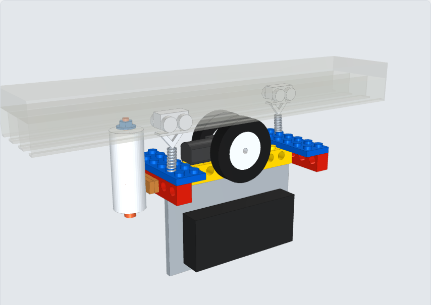

# Assembly (LEGO version)

Interactive model: [`lego-model.html`](lego-model.html) (download and open in a browser).

## 1. Frame

1. Lay the **Technic brick 1×10** (spine) along the rail.
2. Put a **Technic brick 1×6** across each end and lock them with a **plate 2×6** on top.
3. Add two zip ties around each spine / cross-brick joint.

## 2. Motor and wheels

1. Push a Ø34 wheel onto each motor shaft, **flat side towards the gearbox**, about 0.5 mm away from it.
2. Put a strip of foam tape on the middle of the spine and lay the motor on it, shafts across the rail.
3. Press a **1×1 brick** in front of the gearbox and a **1×1 plate** behind the motor end as stops.
4. One zip tie around the **round motor body** through the spine hole 24 mm from the centre – never around the gearbox (the wheels sit right beside it).
5. Turn each wheel by hand: nothing may touch it.

## 3. Gliders and springs

1. Remove the rail end cap and slide **one wheeled glider into track 1** and **one into track 3**.
2. Thread a small zip tie through the cross-brick hole **12 mm from the middle**, under each glider (track 1 side at one end, track 3 side at the other), and close it to a ~5 mm loop above the studs.
3. Hook each spring's top loop into a glider's triangular loop and the bottom loop into the zip-tie loop straight below it. Move the carriage until each hole is directly below its glider.
4. **Make both loops the same length.** Smaller loop = more pull. The wheels should grip, but the carriage must still roll when pushed by hand.
5. Hang the curtain's leading hook on the track-1 glider's loop, beside the spring.

## 4. Electronics

1. Zip-tie the **6×10 plate** below the spine.
2. Calliope on the **window side** (LEDs facing out – the LED matrix is the light sensor), AAA holder on the room side.
3. Wire everything as in [wiring.md](wiring.md). Secure wires away from the wheels.

## 5. Charging dock

1. Stack **4 round bricks 2×2 (3941)**. Put the M3 × 45 screw up through them and through the middle slot into the body washer + nut inside the middle track. Tighten – the lips are clamped between washer and bricks.
2. Place the dock where the carriage stops when the curtain is **fully open**.
3. Glue the dock half of the pogo connector to the bottom round brick and the carriage half to the end face of the cross brick, at the same height and centred.
4. Tape the USB cable under the rail past the dock end.

## 6. First run

1. Load `vidga-curtain-carriage-simple.hex` first and test A/B.
2. Check the direction (`OPEN_DIR`) and the travel time.
3. When the dock wiring is done, switch to `vidga-curtain-carriage-dock.hex` and calibrate (see [firmware/README.md](../firmware/README.md)).
