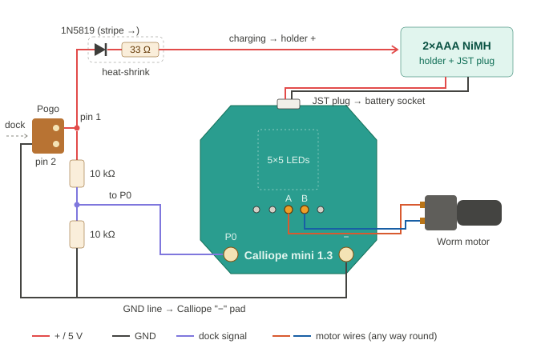

# Wiring

| From | Through | To |
|---|---|---|
| Worm motor (2 wires) | – | Calliope motor pins **A** and **B** (the two middle holes below the LEDs) |
| 2×AAA NiMH holder | JST plug | Calliope **battery socket** |
| Pogo **pin 1** | 1N5819 (stripe towards the battery) → 33 Ω | **AAA holder +** (red wire) |
| Pogo **pin 1** | 10 kΩ | Calliope **P0** pad |
| Calliope **P0** pad | 10 kΩ | GND |
| Pogo **pin 2** | – | Calliope **"−"** pad (GND) |

**Dock side:** USB cable red (+5 V) → dock pogo pin 1, black (GND) → dock pogo pin 2. Nothing else.

## Why two pins are enough

Pin 1 carries 5 V **only while docked**, so it does two jobs:

- **Charging:** 5 V → diode → 33 Ω → batteries. (5 V − 0.3 V − 2.8 V) / 33 Ω ≈ **58 mA**, about 40 mA of which goes into the cells while the Calliope draws ~15 mA. A slow trickle charge, safe to leave on.
- **Dock sense:** the two 10 kΩ resistors halve 5 V to **2.5 V** on P0 → HIGH (and safe for a 3.3 V input).

Away from the dock the diode stops the battery from feeding back into pin 1, and the lower 10 kΩ pulls P0 to 0 V → LOW.

## Rules

- **NiMH only.** Never put alkaline batteries in a holder that is wired to the dock.
- **Never more than 3.3 V on the Calliope 1.3 battery socket.**
- The diode has a direction (stripe = battery side); resistors don't.
- Nothing from the dock goes to motor pins A/B, and nothing goes to the "+" edge pad.
- The drawing is simplified – go by the labels printed on your board.

## Finding the motor pins

Load `firmware/hex/vidga-curtain-motor-pin-test.hex`. Push the motor wires firmly into two holes of the motor pin row.
If the motor turns **both ways in phases 1 and 2**, those are A and B. Phases 3 and 4 (one side to GND) only twitch the motor – that is normal and not used.
